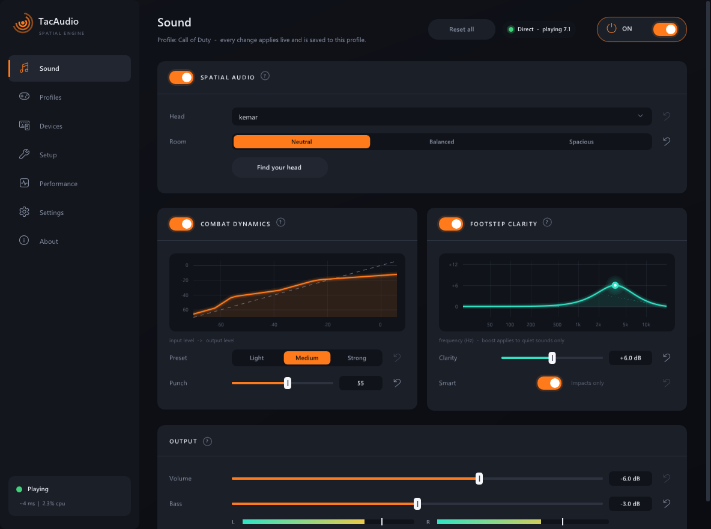
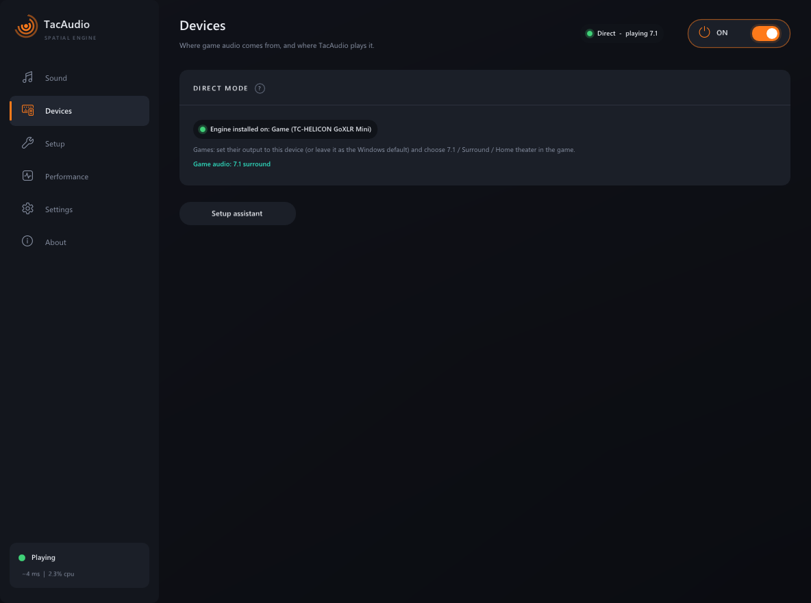
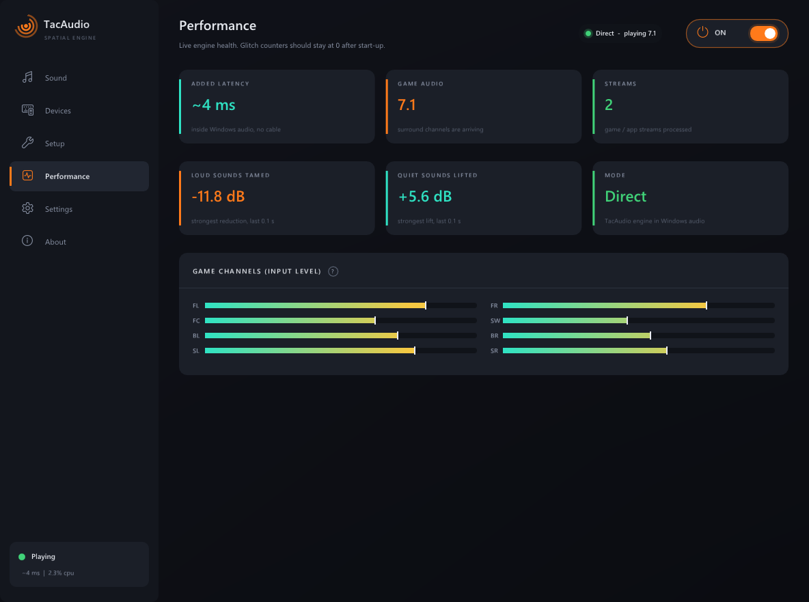
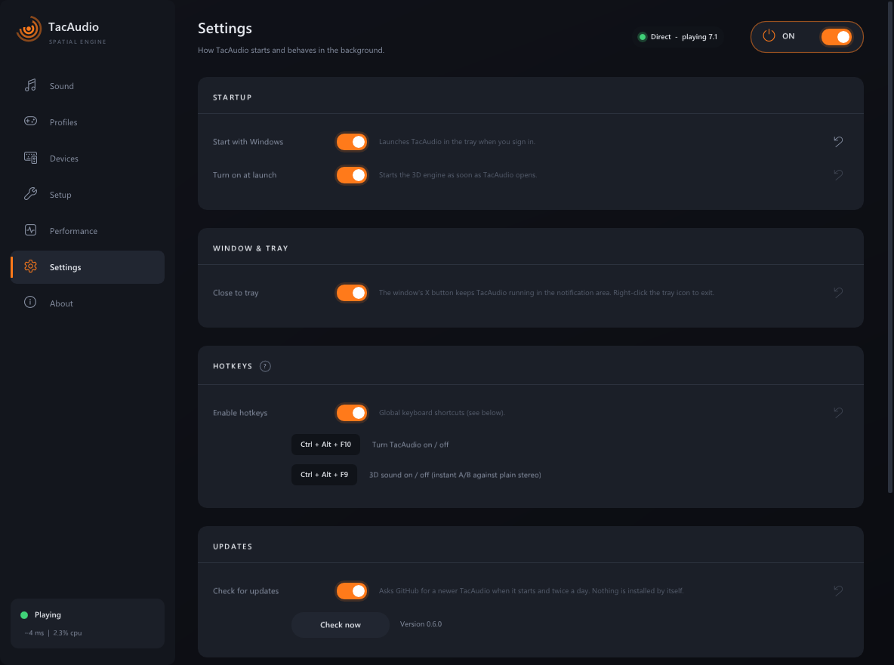
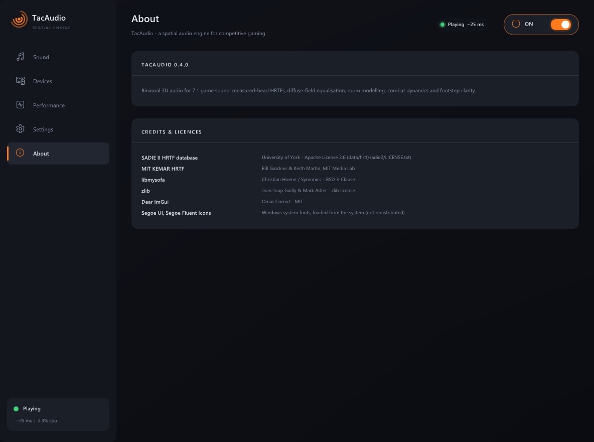
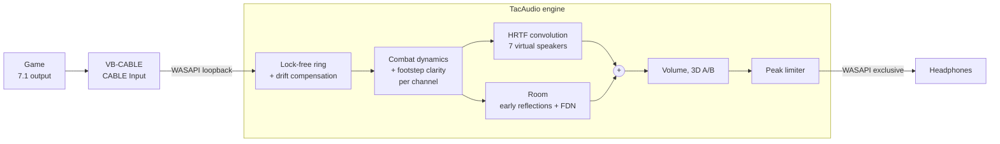

<p align="center">
  
</p>

<h1 align="center">TacAudio</h1>

<p align="center">
  <b>Spatial 3D audio for competitive gaming on Windows.</b><br>
  Precise direction, clean footsteps, tamed gunfire &mdash; on any headphones.
</p>

<p align="center">
  
  
  
  
</p>

<p align="center">
  
</p>

---

## What is TacAudio?

Shooters such as Battlefield and Call of Duty output **7.1 surround**. On headphones you normally
hear a flattened stereo mix, so enemies "behind" and "in front" sound alike. TacAudio turns the
game's 7.1 into **binaural 3D audio** using measured head-related transfer functions (HRTFs), like
commercial headphone virtualisers do &mdash; and then goes further for competitive play:

- **Combat dynamics** pull down gunfire, explosions and killstreak audio while lifting quiet sounds,
  with a **punch** control so gunshots keep their impact.
- **Footstep clarity** lifts the footstep "crunch" band only while a channel is quiet, so loud gun
  cracks in the same band are not boosted.
- **No hidden bass boost**: the subwoofer channel is passed at the level the game mixed it, with an
  optional bass slider.

Everything is adjustable live while you play, from a modern dark app with a tray icon and hotkeys.

## Features

| | |
|---|---|
| 🎧 **Measured heads** | SADIE II KEMAR and Neumann KU100 dummy heads included (+18 human heads optional), diffuse-field equalised so they sound neutral |
| 🏠 **Room presets** | Neutral (dry, most precise), Balanced (small room), Spacious |
| 🔫 **Combat dynamics** | Light / Medium / Strong, per channel and before 3D (a gun on one side never ducks footsteps behind you) |
| 👣 **Footstep clarity** | Quiet-only 3.5 kHz clarity boost, 0 - 12 dB |
| ⚡ **Low latency** | ~25 ms added in exclusive mode; glitch-free adaptive buffering with clock-drift compensation |
| 🔁 **A/B switch** | 3D on/off instantly (Ctrl + Alt + F9) to compare against plain stereo |
| 🖥️ **Everyday app** | Tray icon, start with Windows, global hotkeys, automatic reconnect when a device resets, per-option reset buttons |
| 📊 **Performance page** | Live latency, buffer, CPU, glitch counters and history |

## Download and install

1. Download **`TacAudio-Setup-0.4.1.exe`** from the [Releases](https://github.com/sa3oodi/TacAudio-engine/releases) page.
2. Run it. It installs for your user only (no administrator rights) into
   `%LOCALAPPDATA%\Programs\TacAudio`, with a Start menu entry and an uninstaller in
   *Settings &rarr; Apps*.

> The installer is not code-signed yet, so Windows SmartScreen may warn you.
> Click **More info &rarr; Run anyway**.

### One-time game setup

Games have to output 7.1 into a device TacAudio can read. Until TacAudio ships its own virtual
audio driver, this is the free **VB-CABLE**:

1. Install [VB-CABLE](https://vb-audio.com/Cable/) (run `VBCABLE_Setup_x64.exe` as administrator, then restart).
2. `Win + R` &rarr; `mmsys.cpl` &rarr; *Playback* &rarr; **CABLE Input** &rarr; *Configure* &rarr; **7.1 Surround**;
   *Properties &rarr; Advanced* &rarr; a **48000 Hz** format.
3. *Settings &rarr; System &rarr; Sound &rarr; Volume mixer* &rarr; your game &rarr; output **CABLE Input**.
4. In the game: audio output **7.1 / Surround / Home theater**, and turn off the game's own 3D-headphone mode.
5. In TacAudio's **Devices** page pick *CABLE Input* as source and your headphones as output, then
   switch TacAudio **ON** (top right).

`tacaudio-cli cable-test` verifies that all 8 channels arrive separately (it is inaudible).

## Using TacAudio

| Page | What it's for |
|---|---|
| **Sound** | Head, room, combat dynamics + punch, footstep clarity, volume and bass, live meters. Every option has a &#x21BA; reset button; *Reset all* restores the defaults |
| **Devices** | Game audio source, headphone output, exclusive mode (lowest latency) |
| **Performance** | Latency, buffer, CPU, glitches, how much loud sound is tamed / quiet sound lifted |
| **Settings** | Start with Windows, turn on at launch, close to tray, hotkeys |

| Hotkey | Action |
|---|---|
| `Ctrl + Alt + F10` | TacAudio on / off |
| `Ctrl + Alt + F9` | 3D sound on / off (A/B) |

Closing the window keeps TacAudio running in the tray; right-click the tray icon to exit.

<p align="center">
  
  
</p>
<p align="center">
  
  
</p>

## How it works



1. **Capture**: the game's 8 channels are read from the virtual cable (WASAPI loopback) into a
   lock-free ring buffer. A slowly adapting resampler absorbs the clock difference between the
   cable and your headphones; the buffer grows a little after a glitch and shrinks back when stable.
2. **Dynamics**: each channel is compressed above a threshold and lifted below another, using a
   blend of peak and ~30 ms loudness detection (punch). Footstep clarity adds a 3.5 kHz band only
   while the channel is quiet.
3. **Spatialisation**: every channel is a virtual speaker at its 7.1 position, convolved with the
   chosen head's HRTF pair (uniformly partitioned FFT convolution). The direction-averaged response
   of each head is equalised flat, so the head's own ear resonance does not colour the sound.
4. **Room**: a stereo send feeds early reflections and a 4-line feedback delay network with a
   Hadamard matrix; bass and top end are kept out of it so footsteps stay clean.
5. **Output**: volume, a look-ahead peak limiter and exclusive-mode output at the device's minimum
   period (3 ms on a GoXLR).

Live changes (head, room, dynamics...) swap the whole renderer without clicks: the new one runs
silently for ~20 ms to fill its filters, then crossfades in over ~10 ms.

### Measured

| | Result |
|---|---|
| Added latency, exclusive output | **~25 - 31 ms** (about 20 ms of it is the VB-CABLE step) |
| Added latency, shared output | ~55 ms |
| CPU | ~2 % of one core |
| Gunfire vs. footsteps (battle test scene) | 31 dB &rarr; 21 dB (medium) &rarr; 16 dB (strong) |
| Gunshot crack kept with punch 60 | 32 dB vs. 34 dB without dynamics (24 dB at punch 0) |
| Raw MIT KEMAR average at 2 - 3 kHz | +17.8 dB &rarr; flat within ±1.5 dB after equalisation |

## Build from source

Requirements: Windows 10/11, Visual Studio 2022 or 2026 with the C++ workload, CMake 3.25+,
Python 3 (only to download head data). The configure step downloads zlib, libmysofa and Dear ImGui.

```powershell
cmake -S . -B build -G "Visual Studio 17 2022" -A x64     # or "Visual Studio 18 2026"
cmake --build build --config Release
build\Release\tac_tests.exe                               # unit tests
python tools\fetch_sadie.py                               # SADIE II KU100 + KEMAR (--all: + 18 human heads)
build\Release\TacAudio.exe
```

Installer (needs [Inno Setup 6](https://jrsoftware.org/isinfo.php)):

```powershell
powershell -ExecutionPolicy Bypass -File scripts\build_installer.ps1
# -> dist\TacAudio-Setup-<version>.exe
```

The GitHub Actions workflow (`.github/workflows/build.yml`) builds, tests and packages the
installer on every push.

### Command-line tools

```powershell
tacrender demo renders                    # synthetic 7.1 test scenes -> binaural WAVs
tacrender render in_71.wav out.wav        # any 5.1 / 7.1 / 7.1.4 WAV -> binaural
tacrender heads                           # list head sets;  tacrender audition <dir>: one render per head
tacaudio-cli devices                      # audio devices with periods
tacaudio-cli run --loopback "CABLE Input" --out "Game" --exclusive
tacaudio-cli run ... --latency-test --gain-db -40   # measure added latency stage by stage
tacaudio-cli cable-test                   # verify a virtual cable carries 7.1
```

Shared options: `--head`, `--room`, `--dynamics`, `--punch`, `--footsteps`, `--lfe-db`,
`--gain-db`, `--raw-hrtf`, `--spherical`, `--block`.

## Project layout

```
src/core/          DSP, no dependencies: FFT, partitioned convolver, HRTF sets + diffuse-field EQ,
                   VBAP, binaural renderer, room, dynamics, limiter, ring buffer, varispeed, WAV
src/engine/        real-time engine (drift compensation, adaptive buffer, live renderer swap)
src/platform/      WASAPI capture / loopback / render (shared, low-latency, exclusive)
src/sofa/          SOFA HRTF import (libmysofa)
apps/common/       shared CLI helpers, AudioSession (capture -> engine -> render)
apps/tacaudio_gui/ TacAudio.exe: Win32 + Direct3D 11 + Dear ImGui app (ui_widgets = UI kit)
apps/tacaudio/     tacaudio-cli.exe        apps/tacrender/  tacrender.exe
tests/             unit tests (each DSP block against a reference; engine vs. offline; drift, jitter)
tools/             make_icon.py (app icon), fetch_sadie.py (head data)
installer/         Inno Setup script        scripts/  build_installer.ps1
```

## Roadmap

- TacAudio virtual 7.1 driver (replaces VB-CABLE, removes ~20 ms latency; needs Microsoft signing for anti-cheat)
- Game profiles (per-game settings, auto-switch when a game starts)
- Headphone correction EQ per model
- Upmix for stereo-only games
- Code-signed installer and auto-update

## Credits

TacAudio uses the **SADIE II** HRTF database (University of York, Apache-2.0), the **MIT KEMAR**
HRTF measurements (Gardner & Martin, MIT Media Lab), **libmysofa**, **zlib** and **Dear ImGui**.
See [THIRD_PARTY_NOTICES.md](THIRD_PARTY_NOTICES.md).

## Licence

No licence has been chosen for TacAudio's own code yet; until then all rights are reserved by the
author. Third-party components keep their own licences (see above).

## Disclaimer

TacAudio is an independent project. It is not affiliated with or endorsed by DTS / Xperi,
Dolby, Microsoft, SteelSeries, VB-Audio or any game publisher. All trademarks belong to their owners.
