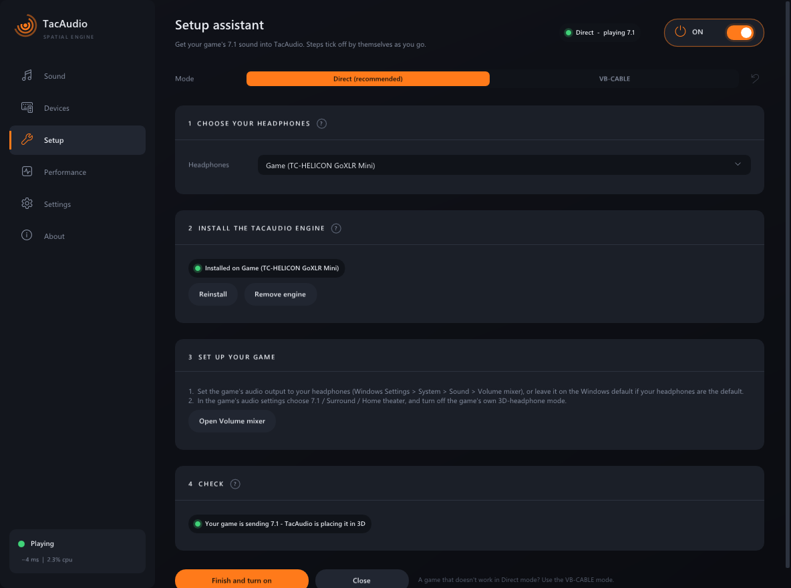
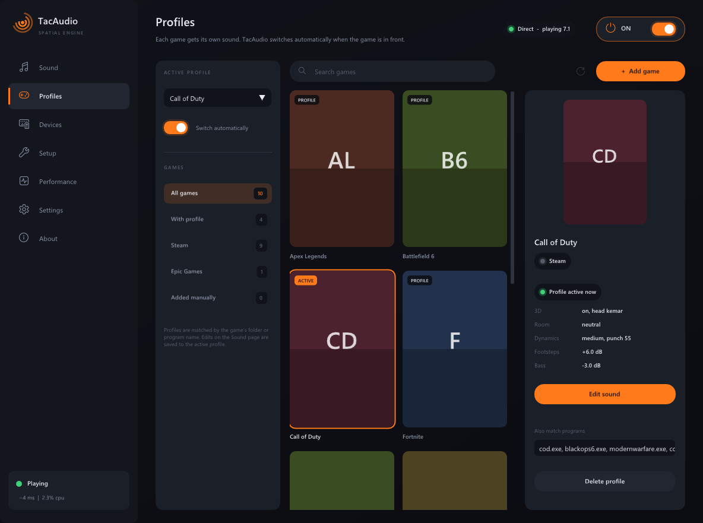
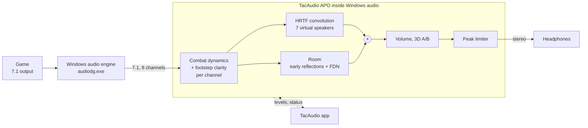

<p align="center">
  
</p>

<h1 align="center">TacAudio</h1>

<p align="center">
  <b>Spatial 3D audio for competitive gaming on Windows.</b><br>
  Precise direction, clean footsteps, tamed gunfire &mdash; on any headphones, no virtual cable.
</p>

<p align="center">
  
  
  
  
</p>

<p align="center">
  
</p>

---

## What is TacAudio?

Shooters such as Battlefield and Call of Duty output **7.1 surround**. On headphones you normally
hear a flattened stereo mix, so enemies "behind" and "in front" sound alike. TacAudio turns the
game's 7.1 into **binaural 3D audio** using measured head-related transfer functions (HRTFs), like
commercial headphone virtualisers do &mdash; and then goes further for competitive play:

- **Combat dynamics** pull down gunfire, explosions and killstreak audio while lifting quiet sounds,
  with a **punch** control so gunshots keep their impact.
- **Footstep clarity** lifts the footstep "crunch" band only while a channel is quiet, so loud gun
  cracks in the same band are not boosted.
- **No hidden bass boost**: the subwoofer channel is passed at the level the game mixed it, with an
  optional bass slider.

TacAudio's engine runs **inside Windows' own audio processing** on your headphones (*Direct mode*):
the game simply plays to your headphones in 7.1, there is no virtual cable, and it adds about
**4 ms** of delay. Everything is adjustable live while you play, from a modern dark app with a tray
icon and hotkeys.

## Features

| | |
|---|---|
| 🎯 **Direct mode** | Engine built into Windows audio on your headphones: no virtual cable, ~4 ms delay, keeps working with the app closed |
| 🎧 **Measured heads** | SADIE II KEMAR and Neumann KU100 dummy heads included (+18 human heads optional), diffuse-field equalised so they sound neutral |
| 👂 **Find your head** | 2-minute listening test: enemy footsteps (boots on gravel, like in a game) walk from 8 directions through each head, you click where you heard them, TacAudio picks the head with the most accurate directions and fewest front/back mix-ups |
| 🏠 **Room presets** | Neutral (dry, most precise), Balanced (small room), Spacious |
| 🔫 **Combat dynamics** | Light / Medium / Strong, per channel and before 3D (a gun on one side never ducks footsteps behind you) |
| 👣 **Footstep clarity** | Quiet-only 3.5 kHz clarity boost, 0 - 12 dB. *Smart* mode lifts only short impacts (steps, landings, reloads) and leaves steady sounds in the same band (rain, wind, engines) alone |
| 🎮 **Game profiles** | Game library (Steam + Epic found automatically, others added by hand) with each game's own sound; switches when the game comes to the front |
| 🎚️ **Headphone EQ** | Import a parametric correction for your headphone model (Equalizer APO / AutoEq format, file or paste); applied after 3D, in both modes |
| ♿ **Footstep ring** | Accessibility option (off by default): a small click-through ring in any corner of the main screen (or the centre) glows towards enemy footsteps. A footstep detector on each 7.1 channel ignores gunfire, explosions, vehicles and rain. Check your game's / tournament's rules before using it competitively |
| 🔁 **A/B switch** | 3D on/off instantly (Ctrl + Alt + F9) to compare against plain stereo |
| 🧭 **Setup assistant** | Installs the engine on your headphones and shows live whether your game is sending 7.1 |
| 📊 **Performance page** | Live level of each of the game's 8 speakers, how much loud sound is tamed and quiet sound lifted |
| 🖥️ **Everyday app** | Tray icon, start with Windows, global hotkeys, per-option reset buttons, update check |
| 🔌 **VB-CABLE mode** | Optional fallback for setups where Direct mode can't be used |

## Download and install

1. Download **`TacAudio-Setup-0.6.0.exe`** from the [Releases](https://github.com/sa3oodi/TacAudio-engine/releases) page.
2. Run it. It installs for your user only into `%LOCALAPPDATA%\Programs\TacAudio`, with a Start
   menu entry and an uninstaller in *Settings &rarr; Apps*.

> The installer is not code-signed yet, so Windows SmartScreen may warn you.
> Click **More info &rarr; Run anyway**.

### One-time setup (about 1 minute)

TacAudio's **Setup assistant** opens on first launch (and any time from the *Setup* page):

1. **Choose your headphones.**
2. **Install engine** &mdash; Windows asks for administrator permission once; sound pauses for a few
   seconds while Windows audio restarts.
3. **Set up your game**: audio output = your headphones (or the Windows default), and in the game's
   audio settings choose **7.1 / Surround / Home theater**. Turn off the game's own 3D-headphone mode.
4. **Check**: start the game &mdash; the assistant shows *"Your game is sending 7.1"* when the back
   and side channels arrive.

<p align="center">
  
</p>

Tested with Call of Duty: Modern Warfare 4 on a GoXLR Mini: full 7.1 arrives, no anti-cheat issues.

**Good to know**
- The engine processes everything played on that headphone device (Discord, browser...). Stereo
  apps stay stereo and pass through the same sound settings.
- Windows' *Audio enhancements* must be enabled for the device (the default).
- Apps that use exclusive or "raw" audio mode bypass Windows' audio effects, and therefore TacAudio.
- *Remove engine* in the Setup assistant (or uninstalling TacAudio) restores the device's original
  Windows effects exactly.

### Optional: VB-CABLE mode

If Direct mode can't be used, the Setup assistant's **VB-CABLE** tab walks you through the older
path: the free [VB-CABLE](https://vb-audio.com/Cable/) virtual device set to 7.1, the game playing
into *CABLE Input*, and TacAudio capturing it and playing to your headphones (~25 ms delay).
It detects the cable and its 7.1 setting, opens the right Windows dialogs and runs an inaudible
8-channel test (`tacaudio-cli cable-test` does the same from the command line).

## Using TacAudio

| Page | What it's for |
|---|---|
| **Sound** | Head (with the *Find your head* test), room, combat dynamics + punch, footstep clarity, volume and bass, live meters. Every option has a &#x21BA; reset button; *Reset all* restores the defaults |
| **Profiles** | Your games as a library of covers. Give a game its own profile (start from Default or another profile); TacAudio switches to it while that game runs and back to Default when it closes. Edits on the Sound page go to the active profile |
| **Devices** | Where the engine is installed (Direct mode), or source / output devices (VB-CABLE mode), and the headphone EQ (*Find your headphones* opens AutoEq, download the "Equalizer APO" parametric file, *Import file*) |
| **Setup** | Setup assistant: Direct mode (recommended) or VB-CABLE |
| **Performance** | The game's 8 speaker levels, streams, how much loud sound is tamed / quiet sound lifted |
| **Settings** | Start with Windows, turn on at launch, close to tray, hotkeys, accessibility (footstep ring: position, size, opacity), update check (asks GitHub for a newer release at launch and twice a day; a banner links to the download, nothing installs by itself) |

| Hotkey | Action |
|---|---|
| `Ctrl + Alt + F10` | TacAudio on / off |
| `Ctrl + Alt + F9` | 3D sound on / off (A/B) |

Closing the window keeps TacAudio running in the tray; right-click the tray icon to exit. In Direct
mode the engine keeps your last settings even when the app is closed.

<p align="center">
  
</p>
<p align="center">
  
  
</p>
<p align="center">
  
  
</p>

## How it works



**Direct mode.** Windows lets audio-effect add-ons (*Audio Processing Objects*, the same mechanism
behind "Audio enhancements" and laptop virtual-surround features) process a playback device.
TacAudio installs one on your headphones. It asks Windows for a **7.1 input while the device stays
stereo**, so a game set to 7.1 delivers all 8 channels to TacAudio, which renders them to 3D stereo
right before the headphones. The app writes the settings to `%ProgramData%\TacAudio\apo.ini` (applied
within 0.1 s) and reads the engine's live status back.

The engine:

1. **Dynamics**: each channel is compressed above a threshold and lifted below another, using a
   blend of peak and ~30 ms loudness detection (punch). Footstep clarity adds a 3.5 kHz band only
   while the channel is quiet.
2. **Spatialisation**: every channel is a virtual speaker at its 7.1 position, convolved with the
   chosen head's HRTF pair (uniformly partitioned FFT convolution). The direction-averaged response
   of each head is equalised flat, so the head's own ear resonance does not colour the sound.
3. **Room**: a stereo send feeds early reflections and a 4-line feedback delay network with a
   Hadamard matrix; bass and top end are kept out of it so footsteps stay clean.
4. **Output**: volume, 3D on/off and a look-ahead peak limiter.

Live changes (head, room, dynamics...) swap the whole renderer without clicks: the new one runs
silently for ~20 ms to fill its filters, then crossfades in over ~10 ms. The audio thread never
allocates, locks or waits; renderers are built on a worker thread.

**VB-CABLE mode** uses the same engine in the app: WASAPI loopback capture of the cable into a
lock-free ring buffer with drift compensation and an adaptive buffer, then exclusive-mode output.

### Measured

| | Result |
|---|---|
| Added delay, Direct mode | **~4 ms** (one 2.7 ms processing block + 1 ms limiter look-ahead) |
| Added latency, VB-CABLE mode | ~25 - 31 ms exclusive output, ~55 ms shared |
| 7.1 through Direct mode | 8 channels arrive discrete (test levels -30 ... -51 dBFS intact) |
| CPU | ~2 % of one core |
| Gunfire vs. footsteps (battle test scene) | 31 dB &rarr; 21 dB (medium) &rarr; 16 dB (strong) |
| Gunshot crack kept with punch 60 | 32 dB vs. 34 dB without dynamics (24 dB at punch 0) |
| Footstep detector (ring): footsteps / rain / gunshot / explosion / silence | 0.90 / 0.03 / 0.00 / 0.00 / 0.00 |
| Smart footsteps: steady band noise / footstep bursts | classic +4.5 / +4.3 dB, smart **+0.0** / +4.0 dB |
| Raw MIT KEMAR average at 2 - 3 kHz | +17.8 dB &rarr; flat within ±1.5 dB after equalisation |

## Build from source

Requirements: Windows 10/11, Visual Studio 2022 or 2026 with the C++ workload and Windows SDK,
CMake 3.25+, Python 3 (only to download head data). The configure step downloads zlib, libmysofa
and Dear ImGui.

```powershell
cmake -S . -B build -A x64
cmake --build build --config Release
build\Release\tac_tests.exe                               # unit tests
build\Release\tacapo-setup.exe selftest                   # drives the APO in-process
python tools\fetch_sadie.py                               # SADIE II KU100 + KEMAR (--all: + 18 human heads)
build\Release\TacAudio.exe
```

Installer (needs [Inno Setup 6](https://jrsoftware.org/isinfo.php)):

```powershell
powershell -ExecutionPolicy Bypass -File scripts\build_installer.ps1
# -> dist\TacAudio-Setup-<version>.exe
```

The GitHub Actions workflow (`.github/workflows/build.yml`) builds, tests and packages the
installer on every push, and publishes a GitHub Release for every `v*` tag.

### Command-line tools

```powershell
tacapo-setup status                       # where the engine is installed, live levels, log
tacapo-setup install --device "Headphones"   # (administrator) install the engine on a device
tacapo-setup uninstall                    # (administrator) remove it, restore the original effects
tacapo-setup play71 --device "Headphones"    # quiet 8-channel test tone (levels show in status)
tacrender demo renders                    # synthetic 7.1 test scenes -> binaural WAVs
tacrender render in_71.wav out.wav        # any 5.1 / 7.1 / 7.1.4 WAV -> binaural
tacrender heads                           # list head sets;  tacrender audition <dir>: one render per head
tacaudio-cli devices                      # audio devices with periods
tacaudio-cli run --loopback "CABLE Input" --out "Game" --exclusive    # VB-CABLE mode engine
tacaudio-cli cable-test                   # verify a virtual cable carries 7.1
```

## Project layout

```
src/core/          DSP, no dependencies: FFT, partitioned convolver, HRTF sets + diffuse-field EQ,
                   VBAP, binaural renderer, room, dynamics, limiter, ring buffer, varispeed, WAV
src/engine/        real-time engine for VB-CABLE mode (drift compensation, adaptive buffer)
src/platform/      WASAPI capture / loopback / render (shared, low-latency, exclusive)
src/sofa/          SOFA HRTF import (libmysofa)
apps/apo/          TacAudioApo.dll (the Direct-mode engine inside Windows audio) + tacapo-setup.exe
apps/common/       CLI helpers, AudioSession, cable check, apo_control (app <-> engine)
apps/tacaudio_gui/ TacAudio.exe: Win32 + Direct3D 11 + Dear ImGui app (ui_widgets = UI kit,
                   profiles = game profiles, game_library = Steam / Epic scan + covers)
apps/tacaudio/     tacaudio-cli.exe        apps/tacrender/  tacrender.exe
tests/             unit tests (each DSP block against a reference; engine vs. offline; drift, jitter)
tools/             make_icon.py (app icon), fetch_sadie.py (head data)
installer/         Inno Setup script        scripts/  build_installer.ps1
```

## Roadmap

- Upmix for stereo-only games
- Code-signed installer

## Credits

TacAudio uses the **SADIE II** HRTF database (University of York, Apache-2.0), the **MIT KEMAR**
HRTF measurements (Gardner & Martin, MIT Media Lab), **libmysofa**, **zlib** and **Dear ImGui**.
See [THIRD_PARTY_NOTICES.md](THIRD_PARTY_NOTICES.md).

## Licence

No licence has been chosen for TacAudio's own code yet; until then all rights are reserved by the
author. Third-party components keep their own licences (see above).

## Disclaimer

TacAudio is an independent project. It is not affiliated with or endorsed by DTS / Xperi,
Dolby, Microsoft, SteelSeries, VB-Audio or any game publisher. All trademarks belong to their owners.
